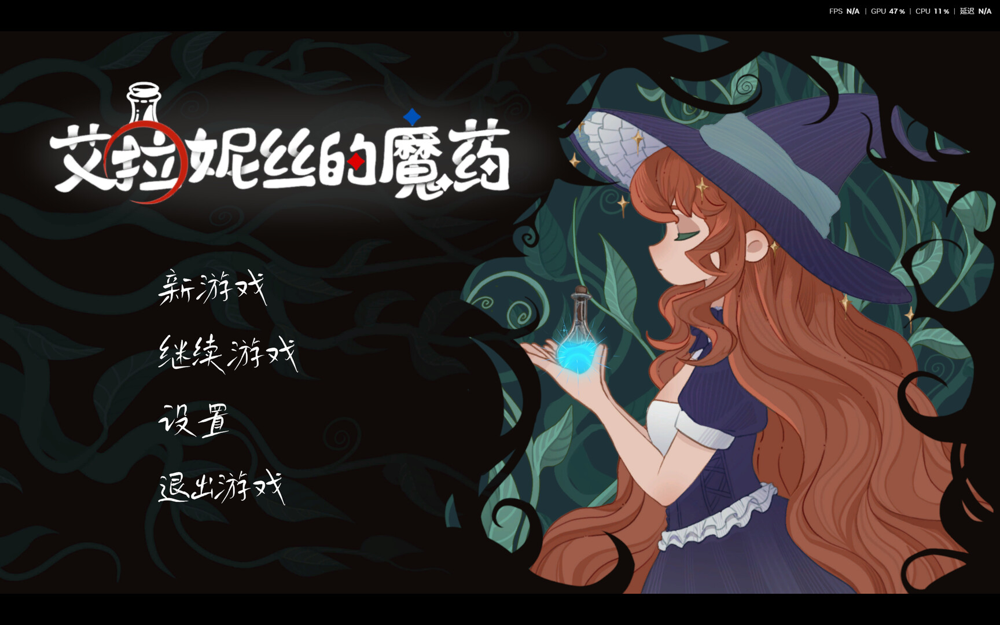
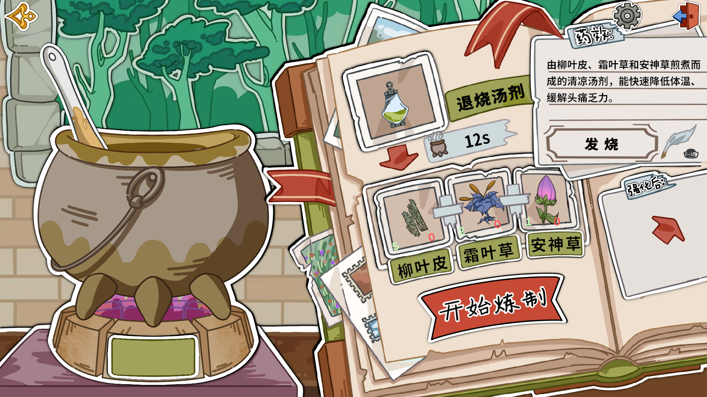
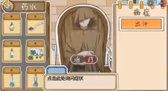
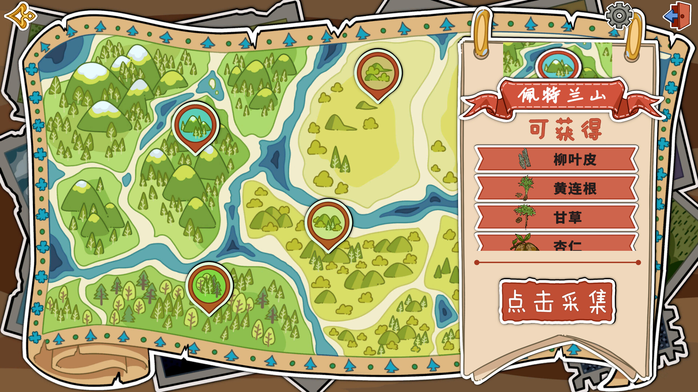

# 艾拉妮丝的魔药（Alanis's Potion）

> 一款使用 **Unity + C#** 独立开发的 **2D 模拟经营 + 叙事 RPG** 游戏。
> 你扮演一位游医，在小镇上经营自己的药铺：炼药、看病、采集、养育、社交，并推进一段中世纪魔幻题材的剧情。



---

##  项目简介

《艾拉妮丝的魔药》是一款偏休闲向的单机游戏，以**叙事 RPG（线性剧情 + 分支选择）**为主线，叠加**模拟经营**的核心玩法循环：

> 采集药材 → 炼制药品 → 为病人看病诊断 → 赚取收入 → 养育养子 → 与 NPC 社交 → 推进剧情。

项目为个人独立开发，从零搭建了完整的客户端框架与玩法系统，覆盖了从「框架层」到「业务层」的分层设计。

##  演示

 **演示视频** [点击查看](https://www.bilibili.com/video/BV1wasA6LEZz)

### 截图

| 玩法     | 截图                             |
| -------- | -------------------------------- |
| 炼药     |   |
| 看病诊断 |   |
| 野外采集 |   |
| 剧情对话 |  |

---

## 技术栈

- **引擎 / 语言**：Unity、C#
- **UI**：UGUI（面板栈、弹窗、Toast 侧边提示）
- **输入**：Unity 新 Input System
- **数据驱动**：ScriptableObject 配置数据库 + CSV 驱动剧情
- **架构模式**：单例、观察者（事件总线）、状态机、工厂、对象池

---

##  核心系统

项目采用 **分层架构（框架层 / 数据层 / 业务层）+ Manager / View 分离** 的设计，核心系统如下：

### 1. 事件总线（观察者模式）
- 全局解耦的 `EventBus`，支持**优先级排序**与**条件过滤**。
- 用于跨模块通信（存档事件、时间事件、对话事件、UI 事件等）。

### 2. 可扩展存档系统
- 通过 `ISaveable` 接口实现「模块自注册」，新增系统无需改动存档主流程。
- **原子写入 + SHA256 完整性校验 + 损坏存档隔离**，保证存档安全。

### 3. 对象池
- 基于 `PoolManager` 的统一对象池，按预制件分池、支持预热。
- 解决频繁创建/销毁 UI 与 NPC 导致的卡顿问题。

### 4. 状态机
- **游戏状态机**（Boot → Start → GameLoop，含 FreeRoam / FullUI / Dialog 子状态）。
- **角色状态机**（Player 的 Idle / Left / Right 移动状态）。

### 5. UI 系统
- `UIManager` 统一管理面板**栈**（导航历史）、层级、转场。
- 黑屏淡入淡出转场、弹窗、Toast 侧边滑入提示。

### 6. 数据驱动
- `ScriptableObject` 配置数据库（草药、药品、病症、症状、NPC、地区、任务）。
- CSV 驱动剧情对话（分支选项、效果指令：认识 / 好感度 / 货币 / 打开商店）。

### 7. 异步编程
- `Task / async-await` 与协程结合，管理资源加载、界面转场与逐帧动画。

### 8. 音频系统
- 双 AudioSource **交叉淡入淡出**切换 BGM，SFX 支持叠加播放。
- 支持按昼夜自动切换背景音乐。

### 9. 昼夜系统
- 游戏时间倍速流逝，昼夜切换驱动场景建筑立绘的**平滑过渡**。

### 10. 捏脸系统
- 运行时通过 `SpriteCombiner` 叠加五官/发型精灵，**合成玩家立绘**。

---

##  玩法系统

| 系统     | 说明                                           |
| -------- | ---------------------------------------------- |
| 炼药     | 选药方 → 看配方 → 后台计时炼制 → 完成弹窗领取  |
| 看病诊断 | 望闻问切 → 症状筛选 → 用药治疗 → 结算奖励/惩罚 |
| 野外采集 | 按区域采集草药，消耗游戏时间                   |
| 养子养成 | 每日安排任务（课程 / 探索），次日结算属性成长  |
| 背包     | 物品分类、选择、出售                           |
| NPC 社交 | 好感度 / 怀疑度、情报系统                      |
| 地图     | 区域传送                                       |
| 商店     | 甜品店 / 草药店交易                            |
| 剧情     | 分支选项、效果指令驱动                         |

---

## 项目结构

```
Assets/
├── 0_Core/        # 框架层：管理器、事件总线、存档、对象池、UI 框架、状态机
├── 1_Data/        # 数据层：模型、ScriptableObject 数据库、存档 DTO、枚举/常量
├── 2_Game/        # 业务层：炼药、看病、采集、养成、社交、对话、剧情等
└── Resources/     # 预制件、配置、素材
```

---

## 设计模式与工程实践

- **单例模式**：全局管理器（`MonoSingleton`）。
- **观察者模式**：事件总线解耦。
- **状态机模式**：游戏状态 + 角色状态。
- **工厂模式**：引导、弹窗等按类型创建。
- **对象池模式**：复用 UI / NPC 实例。

---

## 运行方式

1. 使用 Unity（2022.3 LTS 或更高版本）打开项目根目录。
2. 打开主场景。
3. 点击 Play 运行。

---

## 后续计划

- [ ] 补充更多剧情章节与 NPC
- [ ] 深化看病诊断的推理玩法
- [ ] 丰富养子养成与社交系统

---

## 关于作者

- 亢锐烽
- 方向：Unity 游戏开发
- 邮箱：m18123354209_1@163.com
